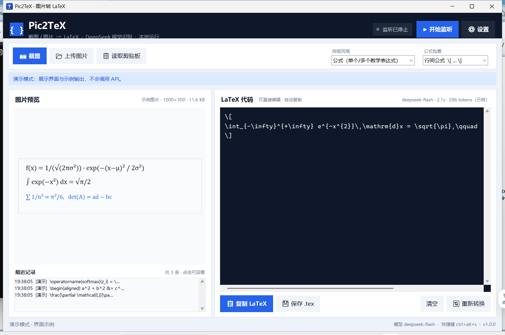

# Pic2TeX · 截图/图片 → LaTeX

[](https://github.com/21aQ/pic2tex/actions/workflows/tests.yml)
[](LICENSE)
[](https://www.python.org/)
[](https://platform.deepseek.com/)

一个 Windows 桌面小工具：**截图或上传图片 → 自动识别 → 输出可直接使用的 LaTeX 代码**。
使用 DeepSeek 视觉模型（`deepseek-flash`）识别公式、手写推导、整页文档，纯 Python 标准库实现，零第三方依赖即可运行。



## 功能特性

- **监听 Win+Shift+S 截图**：一键开启/停止监听。Windows 截图工具把截图写入剪贴板后，程序自动识别并生成 LaTeX，无需保存文件。
- **可开关的监听**：右上角「开始监听 / 停止监听」，状态实时显示；默认启动即监听，可在设置中关闭。
- **全局快捷键**：监听开启时按 `Ctrl+Alt+S` 直接调出系统截图浮层（等价于 Win+Shift+S），框选后自动转换。
- **上传 / 粘贴图片**：支持 `PNG / JPEG / GIF / WebP / BMP`，可从文件对话框选择、按 `Ctrl+V` 粘贴剪贴板图片，或把图片作为命令行参数打开。
- **两种排版风格**：`公式`（只输出数学表达式）与 `整页文档`（输出可编译的完整 `.tex` 文档）。
- **公式包裹可选**：行间公式 `\[ … \]`、行内公式 `$ … $`、不包裹。
- **结果可编辑**：LaTeX 输出框可直接修改；一键复制（原生剪贴板，关闭程序后仍保留）、保存 `.tex`、重新识别。
- **自动复制**：识别完成后自动把 LaTeX 复制到剪贴板（可关闭），复制后直接去 Overleaf/VS Code 粘贴。
- **历史记录**：保留最近 30 次结果，点击即可回看图片和代码。
- **单实例本地运行**：API Key 只保存在本机 `%APPDATA%\Pic2TeX\config.json`（也可用环境变量），代码与图片不经过任何中间服务器，仅调用 DeepSeek 官方 API。
- **零依赖**：不需要 `pip install`（可选安装 Pillow 以获得 JPEG/WebP 缩略图预览）。
- **CLI 模式**：支持单张/批量转换、剪贴板监听、连接检查，方便脚本化。

## 系统要求

- Windows 10 / 11（剪贴板监听与全局快捷键基于 Win32 API）
- Python 3.11+（[python.org](https://www.python.org/downloads/)，安装时勾选 “Add python.exe to PATH”）
- 一个 DeepSeek API Key（[platform.deepseek.com/api_keys](https://platform.deepseek.com/api_keys)）

> 本程序使用 DeepSeek 官方的视觉模型 `deepseek-flash`，通过 OpenAI 兼容接口调用。
> 官方文档：[Vision | DeepSeek API Docs](https://api-docs.deepseek.com/guides/vision/)

## 快速开始

```powershell
# 1. 获取代码
git clone https://github.com/21aQ/pic2tex.git
cd pic2tex

# 2. 启动图形界面（无第三方依赖）
双击「启动 Pic2TeX.bat」，或者：
py -3 -m pic2tex --gui
```

3. 点击右上角 **「⚙ 设置」**，填入 DeepSeek API Key，保存。
4. 点击 **「▶ 开始监听」**。
5. 按 **`Win + Shift + S`** 框选公式，松开鼠标后 LaTeX 会自动出现在右侧窗口，并已复制到剪贴板。
6. 打开 Overleaf / VS Code，直接 `Ctrl+V` 粘贴。

> 不想用图形界面？也可以 `set DEEPSEEK_API_KEY=sk-...` 后用命令行：
> `py -3 -m pic2tex formula.png -o formula.tex`

## 使用方式

### 1. 截图监听（推荐）

1. 点击 **「▶ 开始监听」**（或保持默认的启动自动监听）。
2. 按 `Win + Shift + S`（或程序内 `Ctrl+Alt+S`）截图。
3. 截图进入剪贴板后，程序 0.3 秒内检测到并自动识别。
4. 右侧出现 LaTeX → 已自动复制，可直接粘贴；也可点「保存 .tex」。

监听可以随时点击 **「■ 停止监听」** 关闭；停止后不会再自动处理剪贴板内容。

### 2. 上传 / 粘贴图片

- 点击 **「📂 上传图片」**（或 `Ctrl+O`）选择本地图片。
- 在窗口内按 **`Ctrl+V`** 粘贴剪贴板中的图片。
- 也可以把图片拖到 `Pic2TeX.pyw` 快捷方式上，或用命令行参数打开：
  `py -3 -m pic2tex --gui D:\paper\formula.png`

### 3. 命令行

```powershell
# 转换单张图片，输出到终端
py -3 -m pic2tex formula.png

# 批量转换并写入一个 .tex 文件
py -3 -m pic2tex a.png b.png c.jpg -o formulas.tex

# 整页文档风格 + 不包裹
py -3 -m pic2tex page.png --style document --wrapper none

# 监听剪贴板：每次截图后把 LaTeX 打印到终端
py -3 -m pic2tex --watch

# 检查 API Key / 网络连接
py -3 -m pic2tex --check

# 打开图形界面（默认）/ 演示模式（不调用 API）
py -3 -m pic2tex --gui
py -3 -m pic2tex --demo
```

## 排版风格与包裹方式

| 设置 | 取值 | 说明 |
| --- | --- | --- |
| 排版风格 | `math`（公式） | 只转录数学内容，适合截图公式、手写推导 |
| 排版风格 | `document`（整页文档） | 输出包含 `\documentclass` … `\end{document}` 的完整文档，适合整页论文/笔记 |
| 公式包裹 | `display`（行间） | 结果外层加 `\[ … \]`，默认 |
| 公式包裹 | `inline`（行内） | 结果外层加 `$ … $` |
| 公式包裹 | `none`（不包裹） | 只输出公式主体/环境 |

多行公式会使用 `aligned`、`cases`、`matrix` 等环境；程序不会重复包裹已有的公式环境或完整文档。

## 快捷键

| 快捷键 | 功能 |
| --- | --- |
| `Win + Shift + S` | 系统截图（程序监听剪贴板自动识别） |
| `Ctrl + Alt + S` | 程序全局快捷键：调出系统截图浮层（可在设置中修改/关闭） |
| `Ctrl + V` | 粘贴图片（焦点不在输入框时） |
| `Ctrl + O` | 上传图片 |
| `Ctrl + Enter` / `F5` | 重新识别当前图片 |
| `Ctrl + S` | 保存 `.tex` |
| `Ctrl + Alt + S` | 仅在监听开启时生效；若被其他软件占用，设置里换一个组合 |

## 配置

配置文件：`%APPDATA%\Pic2TeX\config.json`（首次保存设置时自动创建）。

| 字段 | 默认值 | 说明 |
| --- | --- | --- |
| `api_key` | 空 | DeepSeek API Key |
| `base_url` | `https://api.deepseek.com` | OpenAI 兼容接口地址（可换成代理） |
| `model` | `deepseek-flash` | 视觉模型 |
| `prompt_style` | `math` | `math` / `document` |
| `wrapper` | `display` | `display` / `inline` / `none` |
| `auto_copy` | `true` | 识别后自动复制到剪贴板 |
| `auto_monitor` | `true` | 启动程序时自动开始监听 |
| `start_with_current` | `false` | 开启监听时是否转换剪贴板里已有的旧截图 |
| `hotkey_enabled` | `true` | 是否注册全局快捷键 |
| `hotkey` | `ctrl+alt+s` | 全局快捷键 |
| `timeout` | `180` | 单次请求超时（秒） |
| `max_tokens` | `8192` | 最大输出 token |
| `temperature` | `0.0` | 采样温度（识别任务建议 0） |
| `detail` | `original` | 图片精度：`original/high/low/auto` |
| `stream` | `true` | 流式显示生成过程 |
| `save_dir` | 空 | 保存 `.tex` 的默认目录（空则 `文档\Pic2TeX`） |
| `history_limit` | `30` | 历史记录条数 |

环境变量（优先级高于配置文件）：

| 变量 | 说明 |
| --- | --- |
| `DEEPSEEK_API_KEY` | API Key |
| `DEEPSEEK_BASE_URL` | API 地址 |
| `PIC2TEX_MODEL` / `DEEPSEEK_MODEL` | 模型名称 |

> 提示：API Key 以明文保存在本机配置文件中。公用电脑请改用环境变量，或在使用后清空设置中的 Key。

## 打包成独立 exe

```powershell
# 自动安装 PyInstaller 并打包（默认使用 Python 3.11，若不存在则用 3.x）
powershell -ExecutionPolicy Bypass -File .\packaging\build_exe.ps1
# 产物：dist\Pic2TeX.exe（单文件、无控制台窗口，可直接分发）
```

打包脚本会把 `assets\`（图标、演示图片）一起打进 exe。也可以使用 GitHub Actions 的 **Build Windows exe** 工作流，在 Actions 页面下载构建产物。

创建桌面快捷方式（源码运行方式）：

```powershell
powershell -ExecutionPolicy Bypass -File .\packaging\install_shortcut.ps1
```

## 项目结构

```
pic2tex/
├─ Pic2TeX.pyw               # 双击启动 GUI
├─ pic2tex/
│  ├─ app.py                 # 入口：GUI / CLI / --watch / --check
│  ├─ gui.py                 # Tkinter 界面与工作线程
│  ├─ config.py              # 配置读写与环境变量
│  ├─ api.py                 # DeepSeek 视觉 API 客户端（urllib + SSE 流式）
│  ├─ clipboard.py           # Win32 剪贴板监听（CF_DIB/DIBV5/PNG/CF_HDROP）
│  ├─ imageio.py             # 纯标准库图片编解码：DIB/BMP → PNG
│  ├─ hotkey.py              # 全局快捷键（RegisterHotKey）
│  ├─ latex.py               # 去 Markdown 围栏、公式包裹、括号检查
│  ├─ prompts.py             # 公式/整页文档提示词
│  ├─ winutil.py             # DPI、原生剪贴板、截图工具、资源路径
│  └─ models.py              # ImagePayload 数据模型
├─ tests/                    # 离线单元测试（无需网络/API Key）
├─ tools/make_icon.py        # 生成多尺寸 .ico（纯标准库）
├─ packaging/                # 打包与快捷方式脚本
├─ assets/                   # 图标、界面截图、演示公式图
└─ .github/workflows/        # CI：测试 + 构建 exe
```

## 测试

```powershell
py -3 -m unittest discover -s tests -v
```

测试覆盖：PNG 编解码与 DIB 像素转换、剪贴板格式优先级、DeepSeek 请求/流式/错误重试（本地 mock 服务器）、提示词与 LaTeX 后处理、配置读写、GUI 构建冒烟测试。全部离线运行，不需要 API Key。

## 常见问题

**Q：Win+Shift+S 截图后没有反应？**
A：确认已点「开始监听」；确认 Windows 截图工具在截图后确实把图片放进了剪贴板（Win11 默认如此）。可以点「📋 读取剪贴板」手动验证。若使用第三方截图软件，确认它会把图片写入剪贴板（部分软件只保存文件，此时请用「上传图片」）。

**Q：提示 `API Key 无效或无权限` / `余额不足`？**
A：到 [DeepSeek 开放平台](https://platform.deepseek.com/) 检查 Key 是否有效、账户是否有余额；确认设置里的 API 地址是 `https://api.deepseek.com`。

**Q：`Ctrl+Alt+S` 没反应？**
A：可能被其他软件占用。进入「设置」换一个快捷键，或直接按 `Win+Shift+S`。全局快捷键只在监听开启时注册。

**Q：JPEG/WebP 图片没有预览？**
A：内置预览只支持 PNG/GIF（Tk 能力所限）。安装可选依赖后可预览全部格式：`py -3 -m pip install pillow`。识别与转换不受影响。

**Q：识别结果有多余的 ``` 或解释文字？**
A：程序会自动去掉 Markdown 代码围栏与“以下是”等前缀；若仍有残留，直接在输出框里改，或点「🔄 重新转换」。温度默认 0 已尽量减少发散。

**Q：能把 API 换成其他 OpenAI 兼容的视觉模型吗？**
A：可以。设置里改「API 地址」和「模型」即可（需支持 OpenAI `image_url` 内容块格式）。

## 隐私与安全

- 图片只会发送给设置的 API 地址（默认 DeepSeek 官方 `api.deepseek.com`），不经过任何第三方中转。
- API Key 保存在本机 `%APPDATA%\Pic2TeX\config.json`，不会写入日志、仓库或网络请求之外的地方；日志文件 `pic2tex.log` 也不记录 Key。
- 截图监听只在**监听开启**时工作；停止后不再读取剪贴板。
- 本仓库不包含任何真实 API Key；请勿把个人 Key 提交到 Issue 或代码里。

## English

**Pic2TeX** is a small Windows desktop app that turns screenshots or image files into LaTeX code using DeepSeek's vision model (`deepseek-flash`).

- Watch the clipboard: press `Win+Shift+S`, and the screenshot is converted automatically (toggleable).
- Upload or paste images (`Ctrl+V`), or pass a file path on the command line.
- Output math-only or a full compilable LaTeX document; wrap as display/inline/raw.
- Copy the result automatically to the clipboard, save it as `.tex`, or browse recent history.
- Stdlib-only (Python 3.11+), no `pip install` required; optional Pillow improves JPEG/WebP previews.
- CLI: `py -3 -m pic2tex image.png`, `--watch`, `--check`, `--style`, `--wrapper`.

```powershell
git clone https://github.com/21aQ/pic2tex.git
cd pic2tex
set DEEPSEEK_API_KEY=sk-...
py -3 -m pic2tex --gui
```

Set your API key in the app settings, click **Start monitoring**, press `Win+Shift+S`, and paste the generated LaTeX anywhere. MIT licensed.

## License

[MIT](LICENSE) © 2026 21aQ

---

如果这个工具帮到了你，欢迎 Star ⭐。

